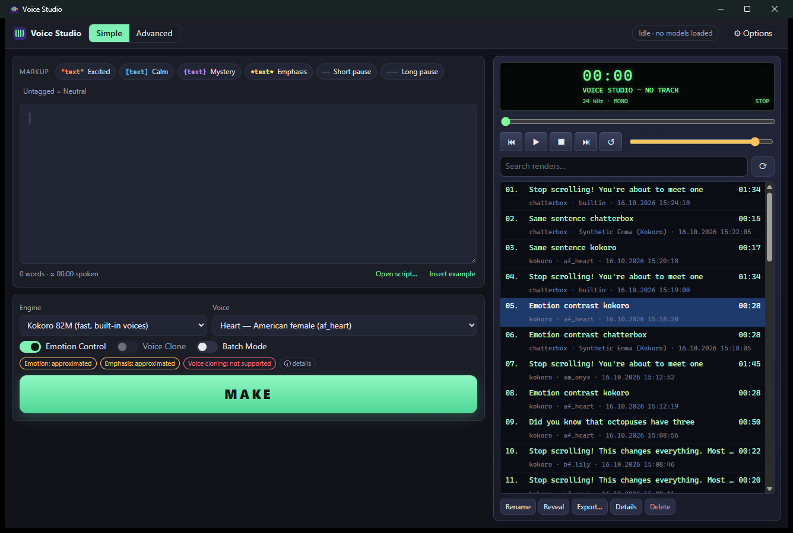

# Voice Studio

Offline, expressive text-to-speech for narration and Shorts. Write a tagged script, press
**MAKE**, get a loudness-normalized, click-free WAV (and MP3 when FFmpeg is present) in a
searchable project folder. No account, no cloud — after models are downloaded everything runs
on your machine.

* **Rust + Tauri 2** desktop app; installer ≈ **3.2 MB (NSIS) / 4.5 MB (MSI)** on Windows,
  models excluded.
* **Kokoro 82M** runs natively in Rust through ONNX Runtime (downloadable runtime: CPU,
  DirectML, CoreML).
* **Chatterbox** (MIT) provides real zero-shot voice cloning and a genuine emotion-intensity
  control. It runs in an optional, isolated, downloaded Python runtime — never in-process.
* Every control is labelled honestly as **genuine / approximated / not supported**.

> Not every TTS model can run natively in Rust, and this app does not pretend otherwise:
> Kokoro is native ONNX; Chatterbox needs PyTorch and therefore its own sandboxed worker.



## Features

| Area | What you get |
|------|--------------|
| Editor | Always-visible markup legend above the editor (click to wrap selection, Ctrl+1…6), live colour highlighting, unbalanced-markup warnings, word count / duration estimate, draft autosave. |
| Markup | `"excited"`, `[calm]`, `{mystery}`, `*emphasis*`, `--` short pause, `---` long pause, untagged = neutral. Deterministic parser, words never lost — see [docs/MARKUP.md](docs/MARKUP.md). |
| Main window | Voice selector, **Emotion Control / Voice Clone / Batch Mode** toggles, big MAKE button, progress + cancel, Simple and Advanced modes (Simple keeps the legend and everything essential). |
| Advanced | Pause lengths, sentence gap, speaking rate, loudness target, seed, title, and a segment inspector showing exactly how the script is split and which controls are genuine. |
| Player | Winamp-style playlist: play / pause / stop / seek / prev / next / replay, volume, spectrum, search, rename (F2), reveal in folder, export WAV/MP3, details, delete. |
| Voice profiles | Import 30–60 s WAV/MP3/FLAC/OGG/M4A, waveform trim, preview, quality check (duration, SNR, clipping, silence, sample rate), named reusable profiles, mandatory rights/consent confirmation. |
| Clone modes | **Voice Only** (reference = identity, markup drives delivery) and **Voice + Style** (reference energy/cadence, markup intensity off). Chatterbox cannot fully separate identity from style; the UI says so. |
| Production | Sequential segments with a fixed seed per project, silence trim, 6 ms fades, exact pause insertion, equal-power joins, ITU-R BS.1770-4 loudness normalization (default −16 LUFS) + peak limiter (−1 dBFS). |
| Projects | `Projects/<date> <title> [id]/` with `project.json` (versioned), `script.txt`, settings, `reference.wav`, `segments/NNN.wav`, `final.wav`, `final.mp3`. |
| Cache | Unchanged segments are reused; key = SHA-256 of text runs + model weights hash + voice/reference hash + style params + seed. |
| Batch | Persistent queue for 20+ scripts (`===` separated or multiple files), start / pause / cancel / retry / resume after crash. |
| Models | Options › Models: download manager (destination folder, SHA-256 verification, HTTP resume, storage estimate, import existing files, remove), plus a catalog of 24 evaluated models with license and commercial-use terms. Unsupported models are marked as such. |
| Resources | No model loaded until MAKE; one job at a time in a background worker; idle unload (default 5 min); automatic device selection with CPU fallback. |
| Diagnostics | Live RSS/CPU of the app and worker, loaded engines, GPU memory, paths, recent log, unload button. |

## Verified results (this machine)

Measured on Windows 11, i7-13650HX (14 cores), 64 GB RAM, RTX 4050 Laptop 6 GB.
Full numbers and method: [docs/BENCHMARKS.md](docs/BENCHMARKS.md).

* Kokoro fp32, CPU: 60 s narration rendered faster than real time (see benchmarks for RTF);
  Whisper transcription of the output: **WER 1.3 %**.
* Chatterbox clone (CUDA) from a 41 s authorized synthetic reference: Whisper **WER 0.0 %**,
  speaker-embedding cosine similarity to the reference **0.938** vs **0.616** for Chatterbox's
  built-in voice on the same text; segment-to-centroid similarity ≥ 0.89.
* Idle (after start-up settles): ≈ 0.1 % of one CPU core for the whole process tree, no model
  memory; app process ≈ 32–41 MB RSS plus the system WebView.
* 75 unit tests + 7 end-to-end tests with real models pass (`cargo test`).

Built and tested **only on Windows x64** so far. macOS (universal .dmg) and Linux x64
builds are configured in CI ([.github/workflows](.github/workflows)) but have **not** been run
on those machines by the author — treat them as unverified until CI artifacts are tested.

## Install & first run

1. Run `Voice Studio_<version>_x64-setup.exe` (per-user, no admin) or the MSI. For the portable
   edition put `voice-studio.exe` in a folder together with an empty `portable.txt`.
2. Options › Models → download **Kokoro 82M fp32**, **Kokoro English voices**, **misaki lexicon**
   and the **ONNX Runtime** for your platform (≈ 380 MB total).
3. Optional for cloning: download **Chatterbox weights** (3.2 GB) and **Install runtime**
   (Python 3.11 + PyTorch, ≈ 3.5 GB with CUDA, ≈ 1.2 GB CPU-only).
4. Write a script, press **MAKE** (Ctrl+Enter). The render appears in the playlist.

Data lives in `%LOCALAPPDATA%\VoiceStudio` (Windows), `~/Library/Application Support/VoiceStudio`
(macOS), `~/.local/share/VoiceStudio` (Linux), or `VOICE_STUDIO_HOME`. Uninstalling or
updating the app does not touch models, voices, settings or projects.

## macOS (.dmg)

* One **universal** `.dmg` runs natively on Apple Silicon (M1–M4) and Intel Macs (macOS 11+).
  It is produced by GitHub Actions on a macOS runner (`.github/workflows/ci.yml` artifact
  `voice-studio-universal-apple-darwin`, or a draft release from `release.yml` on a `v*` tag);
  a `.dmg` cannot be built on Windows.
* Fast paths on Mac: Kokoro uses ONNX Runtime's native arm64 / x86-64 build (CPU by default;
  "Prefer GPU" tries CoreML and falls back to CPU). Chatterbox uses PyTorch with **Metal (MPS)**
  on Apple Silicon, with `PYTORCH_ENABLE_MPS_FALLBACK=1` so unsupported ops run on CPU instead
  of failing.
* **Intel Macs: Kokoro only.** Chatterbox needs PyTorch 2.6, which has no Intel-macOS build; the
  app shows it as "not supported on this computer" and does not offer the 3.2 GB download.
* The app is ad-hoc signed, not notarized (that needs a paid Apple Developer ID). On first
  launch, right-click the app → **Open**, or run
  `xattr -dr com.apple.quarantine "/Applications/Voice Studio.app"`.
* The macOS code paths are type-checked on Windows for both `aarch64-apple-darwin` and
  `x86_64-apple-darwin`, but have **not yet been run on a real Mac** — first CI run will tell.

## Build from source

Prerequisites: Rust stable (1.92+), Node 20+, and the platform's Tauri prerequisites:
* **Windows**: Visual Studio Build Tools with "Desktop development with C++" (MSVC + Windows
  SDK), WebView2 (preinstalled on Windows 11).
* **macOS**: Xcode Command Line Tools.
* **Linux**: `libwebkit2gtk-4.1-dev libappindicator3-dev librsvg2-dev patchelf libssl-dev`.

```bash
npm ci
```

```bash
cargo test -p vs-core
```

```bash
npx tauri build
```

Installers land in `target/release/bundle/` (NSIS/MSI on Windows, .app/.dmg on macOS,
AppImage/.deb on Linux). `npx tauri dev` runs with hot reload.

End-to-end tests (need downloaded models):

```bash
cargo test -p vs-core --release --test e2e -- --ignored --test-threads=1
```

UI preview in a normal browser with mocked IPC (layout work only): `npx vite --port 1420` and
open `http://localhost:1420/preview.html`.

## Command line (`vscli`)

Same core, same folders — useful for automation, CI and benchmarks:

```bash
cargo run -p vs-cli --release -- install kokoro-82m-fp32 kokoro-voices-en misaki-lexicon-en onnxruntime-win-x64-directml
```

```bash
cargo run -p vs-cli --release -- say --voice af_heart --file examples/scripts/shorts_hook.txt --mp3
```

```bash
cargo run -p vs-cli --release -- profile add "My voice" my_reference.wav --consent
```

```bash
cargo run -p vs-cli --release -- say --engine chatterbox --clone <profile-id> --file examples/scripts/shorts_hook.txt
```

Also: `packages`, `adopt`, `verify`, `remove`, `runtime install|probe|remove`, `voices`,
`profiles`, `batch <file>`, `bench`, `idle`, `diag`. Objective checks of a render (Whisper WER,
speaker similarity) are in `scripts/verify_audio.py`.

## Repository layout

```
crates/vs-core     core library (markup, g2p, engines, audio, render, projects, queue, downloads, catalog)
crates/vs-cli      vscli command-line front-end
src-tauri          desktop shell (commands, worker thread)
ui                 front-end (Vite + TypeScript)
worker             isolated Chatterbox Python worker
catalog            packages.json (SHA-256 pinned downloads) + models.json (evaluated models)
examples           example scripts + an authorized synthetic reference voice
scripts            catalog generator, audio verification
docs               MARKUP, ARCHITECTURE, BENCHMARKS
```

## Responsible use

Only clone voices you own or have explicit permission to use; the app requires a consent
confirmation per profile and stores it in the profile. Chatterbox output carries Resemble AI's
imperceptible Perth watermark. Never present synthetic speech as a real person's statement.
Voice similarity varies and is never guaranteed.

## Known limitations

* English only (Kokoro's G2P port and the markup pipeline). No POS tagger: heteronyms use a
  context heuristic ("read", "live").
* Kokoro emotion markup is a prosody approximation, not real emotion.
* Chatterbox: no discrete "mystery" emotion, no emphasis, identity/style entangled; first load
  takes 15–40 s; CPU-only synthesis is several times slower than real time.
* Cancelling a Chatterbox segment kills its worker (the next MAKE reloads it).
* MP3 export requires an FFmpeg with libmp3lame on PATH or configured in Settings.
* DirectML (Windows GPU) was not faster than CPU for Kokoro on the test machine; "auto" uses CPU.

## License

MIT for Voice Studio's code. Models and runtimes keep their own licenses — see
[THIRD_PARTY_LICENSES.md](THIRD_PARTY_LICENSES.md).
